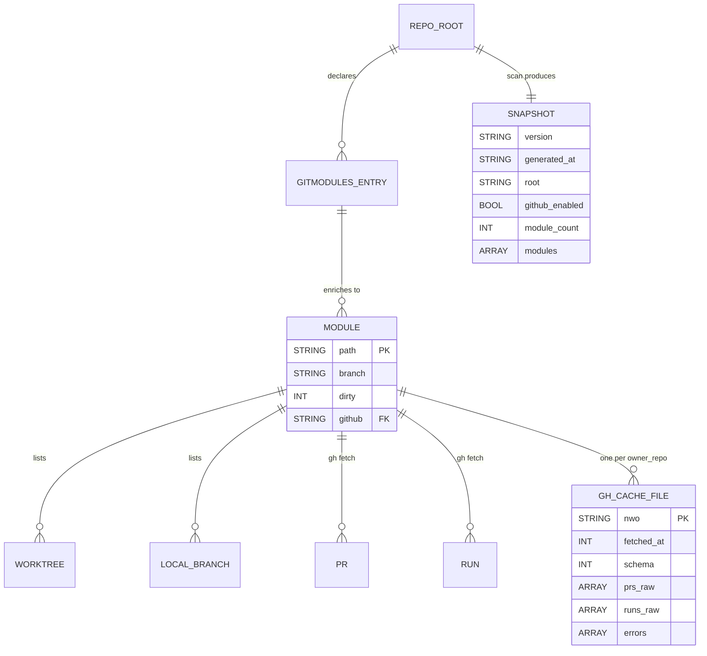

<!-- 〚📁:77fb9f7d-9784-5104-8f7c-f7ec3a0eb497〛 PROJ-SCHEMA :: Data and config artifact reference: cache files, snapshot JSON, env vars. -->
# Project Schema — Data & Config Artifacts

> **No persistence layer.** github-utils is a CLI tool package (bash + Python).
> It has **no database, no SQL schema, and no server-side state**. All durable
> artifacts are: the git-native `.gitmodules` input format, a per-user runtime
> cache/snapshot directory, and shell configuration via env vars / k8-lib config.
> This document covers those instead of table schemas. Schema discovery was
> read-only against the source; no database was contacted (none exists).
>
> Code organization: see [PROJ-LAYOUT.md](PROJ-LAYOUT.md) (`bin/submodule-status`
> wrapper, `lib/submodule_status.py` collector, runtime cache under `~/.cache/submodule-status/`).

## Overview

| Artifact | Kind | Location | Lifetime |
|----------|------|----------|----------|
| `.gitmodules` | Input format (git-native) | Repo root of any scanned repo | Per repo, version-controlled |
| `gh/<owner>__<repo>.json` | GitHub response cache | `~/.cache/submodule-status/` (XDG-aware) | TTL 90 s (default), `--refresh` bypasses |
| `snapshot.json` | Collected scan snapshot | `~/.cache/submodule-status/` | Overwritten per run |
| `dashboard.html` | Rendered HTML dashboard | `~/.cache/submodule-status/` | Overwritten per `--web` run |
| gh-wait output | Data interface (stdout) | stdout (`key=value` lines or `--json` object) | Ephemeral — nothing persisted |
| agh token | Ephemeral credential | Child process env (`GH_TOKEN`) only | ~1 h GitHub-side TTL; never written to disk |
| k8-lib config | Shared shell config | `K8_CONFIG` path via `--config` | Consumed by k8-lib, not by the Python |

## Cache directory

`cache_dir()` resolves to `$XDG_CACHE_HOME/submodule-status` or
`~/.cache/submodule-status/`. Created on demand. **Contains no credentials** —
only raw `gh pr list` / `gh run list` JSON output and derived scan data; GitHub
auth lives entirely in the `gh` CLI's own config.

## `gh/<owner>__<repo>.json` — per-repo GitHub cache

One file per `owner/repo` (slash → `__`, spaces → `_`). Written atomically
(temp file + rename). `schema` is a format version (`CACHE_SCHEMA = 1`).

| Field | Type | Description |
|-------|------|-------------|
| `nwo` | string | `owner/repo` key |
| `fetched_at` | int | Unix epoch seconds of fetch (TTL check) |
| `schema` | int | Cache format version, currently `1` |
| `prs_raw` | array | Raw `gh pr list --json` records (≤ 30 open PRs) |
| `runs_raw` | array | Raw `gh run list --json` records (≤ 8 recent runs) |
| `errors` | array | Per-call error strings from the `gh` invocations |

## `snapshot.json` / `--json` — snapshot format

Written by `write_snapshot()` (default `snapshot.json`, or `--dump <path>`) and
printed by `--json`. Also the IPC payload between the bash wrapper and the
Python collector (`--snapshot` / `SUBMODULE_STATUS_SNAP`).

| Field | Type | Description |
|-------|------|-------------|
| `version` | string | Tool version |
| `generated_at` | string | ISO-8601 UTC timestamp |
| `root` | string | Absolute scanned repo root |
| `github_enabled` | bool | Whether `gh` was usable |
| `github_note` | string | Human note when GitHub was skipped |
| `module_count` / `pr_count` / `failing_count` / `dirty_count` / `worktree_count` / `local_only_count` / `merged_local_count` | int | Rollups |
| `modules` | array | Module records (below), root first |

### `modules[]` record

| Field | Type | Description |
|-------|------|-------------|
| `path` / `abs_path` / `name` | string | Submodule location and display name |
| `gitmodules_url` / `configured_branch` | string | From `.gitmodules` |
| `missing` | bool | Not checked out |
| `staged` / `modified` / `untracked` / `dirty` | int/bool | Working-tree state |
| `branch` / `head` / `head_short` / `detached` | — | HEAD state |
| `worktrees[]` / `wt_count` / `extra_worktrees` | — | `git worktree list --porcelain` parse (with ages) |
| `branches[]` / `local_only[]` / `lo_count` / `merged_into` | — | Local branch inventory, unmerged-branch flags |
| `github` (`owner/repo`) / `repo_url` / `prs_url` / `actions_url` / `branch_url` | string/null | Derived GitHub URLs |
| `prs[]` / `runs[]` / `ci` / `pr_count` | — | Normalized PR + Actions records, CI rollup `{label, state}` |
| `search` | string | Lowercased haystack for fzf filtering |

## ERD — artifact relationships



```plantuml
@startuml
skinparam linetype ortho

TABLE(REPO_ROOT) {
  * path : VARCHAR
}
TABLE(GITMODULES_ENTRY) {
  * name : VARCHAR <<PK>>
  --
  path : VARCHAR
  url : VARCHAR
  branch : VARCHAR
}
TABLE(SNAPSHOT) {
  * generated_at : TIMESTAMP <<PK>>
  --
  version : VARCHAR
  root : VARCHAR
  github_enabled : BOOL
  modules : JSON_ARRAY
}
TABLE(MODULE) {
  * path : VARCHAR <<PK>>
  --
  branch : VARCHAR
  head : VARCHAR
  dirty : BOOL
}
TABLE(GH_CACHE_FILE) {
  * nwo : VARCHAR <<PK>>
  --
  fetched_at : INT
  schema : INT
  prs_raw : JSON_ARRAY
  runs_raw : JSON_ARRAY
}

REPO_ROOT ||--o{ GITMODULES_ENTRY : declares
REPO_ROOT ||--|| SNAPSHOT : "scan produces"
GITMODULES_ENTRY ||--o{ MODULE : enriches
MODULE ||--o{ GH_CACHE_FILE : "caches gh output"
@enduml
```

## Configuration

### Env vars

| Var | Consumer | Purpose |
|-----|----------|---------|
| `XDG_CACHE_HOME` | Python | Cache base dir (default `~/.cache`) |
| `K8_LIB_DIR` | bash wrappers | k8-lib location (default `~/.local/share/k8-lib`) |
| `K8_CONFIG` | k8-lib (set by `--config`) | Path to `k8-util-config.yaml` / `infra-config.yaml` |
| `GITHUB_UTILS_SHARE` / `GITHUB_UTILS_LIB_DIR` | bash wrappers | Python module dir (default `~/.local/share/github-utils`) |
| `SUBMODULE_STATUS_PY` | Python | Override collector script path (wrapper re-invocation) |
| `SUBMODULE_STATUS_SNAP` | Python | Snapshot path for preview/action re-invocations |
| `NO_COLOR` / `FORCE_COLOR` | Python | Disable/force ANSI color |
| `SUBMODULE_STATUS_NO_LINKS` | Python | Disable OSC-8 hyperlinks |
| `TERM` | Python | `""`/`dumb` disables links + color |

### Config files

- **`--config <path>`** is pre-parsed by the bash wrappers into `K8_CONFIG` and
  consumed by the shared **k8-lib** (`config.sh`). The Python collector accepts
  the flag for compatibility but does not read the file itself — the tools work
  with zero configuration.
- No tokens/keys are defined or stored by this package; `gh` handles its own auth.

## gh-wait — result interface (stateless)

`gh-wait` persists nothing: no cache, no state files, no temp artifacts. Every
run is a fresh poll of `gh`/`kubectl` (invoked as list-argv subprocesses). Its
data surface is the output contract, consumed by agents and scripts:

- Exit codes (every subcommand): `0` met/success · `1` met-but-failed ·
  `2` timeout (`--snapshot`: still pending, `result=pending`) · `3` usage/tool error.
- Poll mode prints one `key=value` summary line (`<command> result=… …`) with
  indented detail lines; `--json` prints one object instead.
- `--json` shape (stable fields across subcommands): `result` (`success` /
  `failure` / `pending` / `timeout` / `closed_unmerged` / …), `exit`, the
  command name, plus per-command fields (`pr`, `run`, `sha`, `conclusion`,
  `state`, `argocd_sync`, `argocd_health`, …).
- Token-shaped strings in any output are redacted before printing.
- Only write call: `gh run rerun`, and only behind opt-in `run --rerun-cancelled`.

## agh — ephemeral credential interface

`agh` writes nothing to disk. Data in flight per invocation:

| Item | Where | Lifetime |
|------|-------|----------|
| RS256 JWT (`iss` = app id, `exp` = now+9 min) | `Authorization` header to api.github.com | Single request |
| Installation access token | `GH_TOKEN` env of the exec'd `gh` process | ~1 h (GitHub-side TTL); dies with the process |
| `--print-token` output | stdout, explicit opt-in only | Caller's responsibility — docs warn against caching |

Installation selection inputs: `AGH_INSTALLATION_ID` (pin) or owner resolved
from `-R` / `GH_REPO` / cwd origin against paged `GET /app/installations`.
Errors exit 3; tokens are never echoed outside `--print-token`.

## CI / test config surface

- `.coveragerc` — coverage gate (`fail_under` 60); `bin/gh-wait` measured across subprocesses (`[run] patch = subprocess`).
- `requirements-test.txt` — test deps; also the CI pip cache key.
- `.github/workflows/ci.yml` — `permissions: contents: read`; tests drive scripted fake `gh`/`kubectl` binaries (`tests/fakes/fake_tool.py`), never the real API.

## Notes

- `.gitmodules` parsing reads `submodule.<name>.path|url|branch` via
  `git config -f`; nested `.gitmodules` files are walked recursively.
- Cache misses/expiry are transparent: stale (> TTL) or corrupt JSON is refetched.
