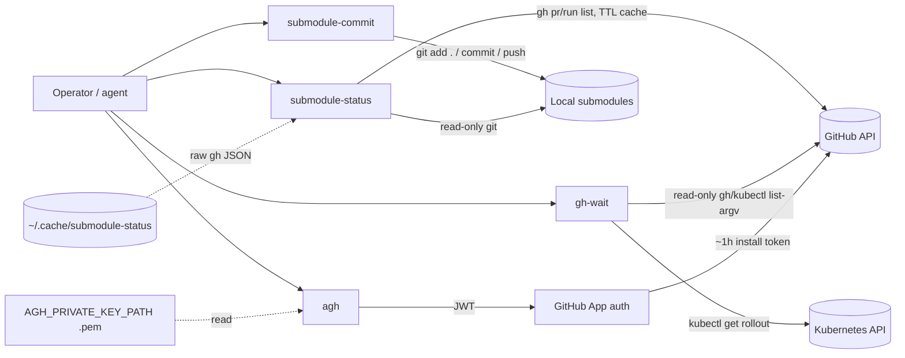

# Threat Model — github-utils

## Overview

github-utils is a set of four stateless developer CLIs (`submodule-status`,
`submodule-commit`, `gh-wait`, `agh`) that run on an operator workstation with
the operator's own privileges. There is **no server, no database, no listener**:
the entire attack surface is the local process boundary and the credentialed
outbound calls the tools make.

Crown jewels, in order of value:

1. **The GitHub App private key** (`AGH_PRIVATE_KEY_PATH`, read by `agh`) —
   possession lets anyone mint installation tokens for the app's installations.
2. **The user's own `gh` and `kubectl` credentials** — delegated to, never
   read or stored by, these tools.
3. **The local git working trees** — `submodule-commit` can bulk-commit and
   bulk-push whatever is dirty across dozens of submodules in one pass.

## Trust Boundaries

| # | Boundary | Crossed by |
|---|----------|------------|
| B1 | Workstation process ↔ local git repositories | `submodule-status` (read), `submodule-commit` (write: add/commit/push) |
| B2 | Workstation ↔ GitHub API | `gh` subprocess with the user's stored auth (`gh-wait`, `submodule-status`); `agh` swaps in a short-lived installation token |
| B3 | Workstation ↔ GitHub App auth | `agh`: PEM on disk → RS256 JWT → installation access token (~1 h) |
| B4 | Workstation ↔ Kubernetes API | `kubectl` subprocess with the user's kubeconfig (`gh-wait deploy` / `release` rollout checks, read-only) |
| B5 | Workstation filesystem ↔ cache dir | `~/.cache/submodule-status/` holds raw `gh` JSON, snapshot, HTML dashboard — no credentials |

## Attack Surface

Entry points are CLI invocations only — no network listeners, no webhooks, no
cron. All four tools print to stdout/stderr and exit.

## Vulnerability Register

| ID | Severity | STRIDE | Component | Status |
|----|----------|--------|-----------|--------|
| T-001 | Low | Information disclosure | Raw `gh` PR/Actions JSON cached in `~/.cache/submodule-status/` persists repo metadata beyond process life on shared hosts | Mitigated — XDG user-only cache dir, no credentials stored, TTL 90 s |
| T-002 | High | Elevation of privilege / Spoofing | Compromise of the `agh` PEM key yields bot identity for every app installation until the key is rotated | Partial — key lives outside git (chmod 600 documented), tokens expire ~1 h and are installation-scoped; rotation/monitoring is external to this repo |
| T-003 | Medium | Information disclosure | `agh --print-token` echoes a live installation token (shell history / scrollback capture) | Mitigated — explicit opt-in flag only, ~1 h expiry, docs warn against caching; residual accepted |
| T-004 | Medium | Tampering / Repudiation | `submodule-commit` stages with `git add .` and pushes deepest-first — secrets sitting dirty in working trees can be committed and published across many repos in one pass | Mitigated — fzf preview shows `git status --short` per repo, `--dry-run` / `--no-push` escapes, per-run confirmation; residual: `--all` skips selection |
| T-005 | Low | Tampering | A malicious `gh`/`kubectl` shim earlier on PATH can feed `gh-wait` false status, steering agent decisions | Open (accepted) — tools trust PATH resolution; `subprocess` uses list argv (no shell interpolation) and output is JSON-parsed, so the blast radius is wrong answers, not code execution |
| T-006 | Low | Elevation of privilege | `gh-wait run --rerun-cancelled` can re-trigger CI workflows | Mitigated — the package's only write API call, behind an explicit flag; visible in Actions audit history |

## Mitigation Coverage

4 mitigated · 1 partial (T-002) · 1 open/accepted (T-005). No open item has a
ticket: T-005 is inherent to CLI trust of PATH and is documented so agents
treat `gh-wait` output as advisory, not a security boundary.

Structural mitigations that bound the whole surface:

- **No secrets are stored by any tool in this package** — `gh` and `kubectl`
  own their credential stores; `agh` mints ephemeral tokens per invocation.
- **`gh-wait` is read-only by construction** (sole write: T-006) and redacts
  token-shaped strings before printing (`redact()`).
- **No shell interpolation** of tool or API output anywhere (`subprocess.run`
  with list argv; bash tools pass quoted arguments).
- **CI runs with `permissions: contents: read`** and tests drive scripted fake
  `gh`/`kubectl` binaries (`tests/fakes/`), so the test suite never touches the
  real GitHub API.

## Residual Risk

Accepted: repo metadata on local disk (T-001), PATH-trust for CLI tooling
(T-005), and the opt-in token echo (T-003). The dominant real-world risk is
T-002/T-004 combined — an agent authorized to run `submodule-commit` and
holding the app key is one prompt-injection away from publishing secrets;
mitigation is operational (least-privilege agents, `--dry-run` first, key
rotation), not code-level. Threat model grounded in
[PROJ-ARCH.md](PROJ-ARCH.md); file placement in [PROJ-LAYOUT.md](PROJ-LAYOUT.md).
